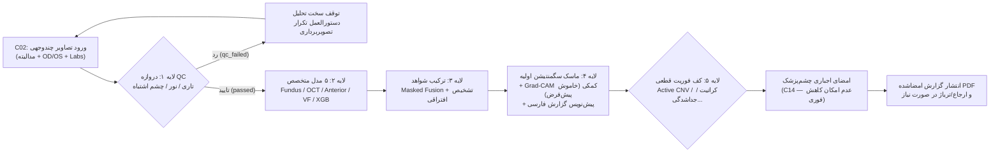
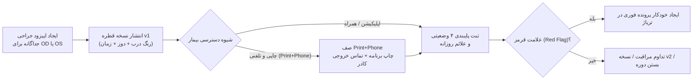

# مستند جامع فرآیندهای وب‌اپلیکیشن کادر درمان بینا (Staff Web)

این مستند تمام فرآیندهای بالینی، عملیاتی، تشخیصی، امنیتی و مدیریتی وب‌اپلیکیشن دسکتاپ کادر درمان (`apps/staff-web/`) را به‌صورت یکپارچه و دقیق بر اساس **PRD v3.0** (`docs/PRD.md`)، **تصمیمات معماری ADR-001..055** (`docs/ADR.md`)، **مشخصات UI/UX نسخه ۲.۰** (`docs/BINA_AI_STAFF_WEB_UI_UX_SPEC_V2.md`) و پیاده‌سازی واقعی مسیرها و قراردادهای OpenAPI 3.1 استخراج و تدوین کرده است.

---

## ۱. اصول غیرقابل نقض ایمنی بالینی، امنیتی و بومی‌سازی (حاکم بر تمام فرآیندها)

1. **جداسازی صریح چشم راست و چپ (`OD` / `OS` Isolation):**
   - هر اپیزود جراحی، نسخه قطره چشمی، آزمون خانگی R2 و مطالعه تشخیصی به‌طور صریح به `OD` (`چشم راست`) یا `OS` (`چشم چپ`) متصل است و هرگز در یک رکورد با هم ادغام نمی‌شوند.
2. **تایید اجباری چشم‌پزشک (Mandatory Ophthalmologist HITL):**
   - هیچ گزارش تشخیصی هوش مصنوعی بدون امضای نهایی چشم‌پزشک (`diagnostic:signoff`) به بیمار یا HIS منتشر نمی‌شود.
   - سامانه هرگز «تشخیص قطعی مستقل»، «تضمین سلامت کامل (All Clear)» یا «تغییر خودکار دارو» تولید نمی‌کند.
3. **سطح‌بندی دقیق ۳گانه فوریت (Exact 3 PRD Urgency Tiers) + کف فوریت قطعی (Deterministic Urgent Floor):**
   - تنها ۳ سطح فوریت مصوب وجود دارد: `عادی` (`routine`)، `پیگیری ۳ تا ۶ ماه` (`followup_3_6m`) و `ارجاع فوری` (`urgent`).
   - در یافته‌های پرخطر قطعی (مانند `Active CNV`، `کراتیت عفونی`، `ادم پاپی`، `جداشدگی شبکیه` و علائم قرمز پس از جراحی)، کف فوریت روی `ارجاع فوری` قفل می‌شود و کاهش آن توسط مدل یا رابط کاربری توسط سرور (`HTTP 422`) مسدود می‌گردد.
4. **تفکیک سگمنتیشن اولیه از Grad-CAM کمکی (`ADR-051`):**
   - ماسک‌های سگمنتیشن پیکسلی (IRF/SRF/Disc) لایه اصلی شواهد بالینی هستند؛ نقشه Grad-CAM به‌صورت پیش‌فرض **خاموش** است و در صورت فعال‌سازی دستی صرفاً با برچسب اجباری `راهنمای توجه مدل — غیرقابل استفاده به‌جای سگمنتیشن دقیق` نمایش داده می‌شود.
5. **برابری بیماران غیرهوشمند (`Print+Phone` Parity):**
   - بیماران فاقد گوشی هوشمند از طریق فرآیند چاپی و تلفنی مدیریت می‌شوند و در مخرج تمام KPIهای کلینیک و کارت امتیاز پایلوت محاسبه می‌گردند.
6. **حفاظت از حریم خصوصی و چندمستاجری (`Tenant RLS` & Zero-PHI Client Storage):**
   - جداسازی داده‌های هر کلینیک/مستاجر در سطح پایگاه داده با `FORCE ROW LEVEL SECURITY` انجام می‌شود.
   - هیچ توکن احراز هویت یا داده PHI بیمار در `localStorage`، `sessionStorage`، کوئری‌های URL یا لاگ‌های مرورگر ذخیره نمی‌شود (احراز هویت صرفاً در RAM).
7. **۱۰۰٪ فارسی (`fa-IR`)، راست‌به‌چپ معنایی (RTL)، تقویم جلالی و بدون CDN خارجی:**
   - تمام تاریخ‌ها به شمسی (جلالی)، ارقام به فارسی، فونت `Vazirmatn` به‌صورت خودمیزبان (Self-Hosted WOFF2) و نام محصول از متغیر مرکزی (`VITE_APP_BRAND_NAME_FA`) خوانده می‌شود.

---

## ۲. نقش‌های کاربری و ماتریس مجوزها (RBAC / Capabilities)

| نقش (`StaffRole`) | عنوان فارسی | حوزه اصلی مسئولیت و دسترسی‌ها | محدودیت‌های کلیدی ایمنی |
| :--- | :--- | :--- | :--- |
| `ophthalmologist` | چشم‌پزشک | بررسی مطالعات AI، امضای نهایی HITL (`diagnostic:signoff`)، انتشار نسخه دارویی (`prescription:publish`)، ایجاد اپیزود، تریاژ، پایش R2، گزارش‌ها | دسترسی مدیریت کلینیک (`admin:manage`) ندارد |
| `optometrist` | اپتومتریست | پذیرش و مشاهده بیماران، بارگذاری مطالعه، بررسی پیش‌نمایش شواهد، پایش خانگی R2، پیگیری و تریاژ | **فاقد مجوز امضای نهایی AI** و انتشار نسخه |
| `technician` | تکنسین تصویربرداری | بارگذاری تصاویر چندوجهی (`study:upload`)، بررسی دروازه کنترل کیفیت (Layer 1 QC) و تکرار تصویربرداری (Recapture) | **فاقد مجوز امضای نهایی AI**، نسخه، تریاژ و مدیریت |
| `coordinator` | هماهنگ‌کننده مراقبت | پذیرش بیمار (`patient:enroll`)، مراقبت پس از عمل و `Print+Phone`، صف تریاژ (`triage:manage`)، پیگیری و ارجاعات بسته‌حلقه | **فاقد مجوز امضای نهایی AI** و انتشار نسخه |
| `admin` | مدیر کلینیک و عملیات | مدیریت کلینیک و کاربران (`admin:manage`)، قالب‌های پیامک و Feature Flags، دستگاه‌ها و اتصالات (`integrations:manage`)، کنسول عملیات و ممیزی (`ops:read`, `audit:read`)، خروجی پژوهشی | **فاقد مجوز امضای بالینی AI** (تفکیک نقش اداری از بالینی) |

---

## ۳. نقشه یکپارچه ۱۳ ماژول (`A` تا `M`) و مسیرهای وب‌اپلیکیشن

| ماژول | نام ماژول | مسیرهای پیاده‌سازی‌شده (`routes.ts`) | ستون محصول |
| :--- | :--- | :--- | :--- |
| **M** | احراز هویت، کلینیک و تنظیمات | `/login`, `/select-clinic`, `/settings`, `/403`, `/404` | مشترک |
| **A** | داشبورد، میز کار و فعالیت‌ها | `/overview`, `/overview/my-work`, `/overview/activity` | مشترک |
| **B** | بیماران و پرونده ۳۶۰ درجه | `/patients`, `/patients/new`, `/patients/:patientId` | مشترک |
| **C** | میز کار تشخیصی هوش مصنوعی (۶ لایه) | `/diagnostics`, `/diagnostics/new`, `/diagnostics/:studyId` | پایلار ۲ |
| **D** | پایش خانگی بینایی (R2) | `/monitoring`, `/patients/:patientId/monitoring/*` | پایلار ۱ (R2) |
| **E** | عملیات مراقبت پس از جراحی و `Print+Phone` | `/care`, `/care/episodes`, `/care/episodes/new`, `/care/print-phone`, `/care/episodes/:episodeId` | پایلار ۱ (R1) |
| **F** | تریاژ ۳ سطحی، تحویل شیفت و اختلالات | `/triage`, `/triage/outages`, `/triage/handoff`, `/triage/history` | مشترک |
| **G** | پیگیری‌ها و ارجاعات بسته‌حلقه | `/follow-ups`, `/follow-ups/referrals` | مشترک |
| **H** | مرکز گزارش‌های رسمی PDF فارسی | `/reports` | مشترک |
| **I** | آمار کلینیک، کارت امتیاز پایلوت و کیفیت AI | `/analytics` | مشترک |
| **J** | مدیریت کلینیک، نقش‌ها و قالب‌ها | `/admin` | زیرساخت |
| **K** | دستگاه‌ها و اتصالات PACS/DICOM/FHIR | `/integrations` | زیرساخت |
| **L** | کنسول عملیات، Step-Up Audit و Break-Glass | `/ops` | زیرساخت |

---

## ۴. شرح کامل تمام فرآیندها (ماژول‌به‌ماژول)

### ماژول M — احراز هویت، ایزولاسیون چندکلینیکی و تنظیمات شخصی

#### فرآیند `P-M1`: ورود کادر درمان با OIDC + MFA و تفکیک محیط زنده از نمایشی
- **مسیر:** `/login` | **API:** `POST /v1/auth/staff/session`, `GET /v1/staff/me`
- **گام‌ها:**
  1. کاربر شناسه/توکن OIDC، شناسه کلینیک (`Clinic UUID`) و در صورت الزام ارائه‌دهنده، کد MFA را وارد می‌کند.
  2. در حالت `VITE_API_MODE=mock` بنر صریح `محیط نمایشی — داده آزمایشی (بدون ارتباط زنده با سرور)` نمایش داده شده و امکان انتخاب یکی از ۴ حساب آزمایشی غیرواقعی (`چشم‌پزشک`, `هماهنگ‌کننده`, `تکنسین`, `مدیر`) فراهم است. در حالت `live` هرگز بازگشت خاموش به داده آزمایشی رخ نمی‌دهد.
  3. پس از تایید، نشست و فهرست دقیق `capabilities` صرفاً در حافظه RAM (`AuthProvider`) ذخیره شده و کاربر به `/overview` هدایت می‌شود.

#### فرآیند `P-M2`: تعویض کلینیک فعال (Clinic Switch) و پاکسازی کامل حافظه
- **مسیر:** `/select-clinic` | **API:** `POST /v1/auth/staff/switch-clinic`
- **گام‌ها:**
  1. کاربر فهرست کلینیک‌های مجاز خود را مشاهده و کلینیک مقصد را انتخاب می‌کند.
  2. سرور توکن جدید با کانتکست مستاجر/کلینیک جدید صادر می‌کند.
  3. کلاینت شمارنده `sessionEpoch` را افزایش می‌دهد تا تمام درخواست‌ها و کش‌های کلینیک قبلی فوراً باطل و پاکسازی شوند و نشت داده بین کلینیک‌ها ناممکن گردد.

#### فرآیند `P-M3`: مدیریت انقضای نشست (`401`)، کنترل دسترسی (`403`) و خروج امن
- **مسیرها:** `/403`, `/404`, دکمه خروج در هدر
- **گام‌ها:** هر پاسخ `401` نشست را فوراً از RAM پاک کرده و کاربر را با اعلان انقضا به `/login` برمی‌گرداند. دسترسی به مسیرهای بدون مجوز (`RequireCapability`) صفحه `دسترسی به این بخش مجاز نیست` را با ذکر مجوز لازم نمایش می‌دهد.

#### فرآیند `P-M4`: شخصی‌سازی محیط کاری بدون ذخیره PHI
- **مسیر:** `/settings`
- **گام‌ها:** کاربر می‌تواند تم (`روشن` / `تیره` / `سیستم`)، ظاهر سایدبار (`روشن آکوا` / `سبز-آبی تیره`) و تراکم رابط کاربری (`فشرده دسکتاپ` / `راحت`) را تغییر دهد. صرفاً همین تنظیمات غیرحساس UI در `localStorage` ذخیره می‌شوند.

---

### ماژول A — داشبورد کلینیک، میز کار و جستجوی سراسری

#### فرآیند `P-A1`: رصد عملیاتی روزانه کلینیک (Clinic Overview)
- **مسیر:** `/overview` | **API:** `GET /v1/overview/dashboard`, `GET /v1/overview/activity`
- **گام‌ها:**
  1. نمایش بنر هشدار فوری در صورت وجود پرونده `ارجاع فوری` باز یا عبور از SLA.
  2. نمایش ۵ کارت KPI فشرده: اپیزودهای فعال `OD / OS`، بیماران `Print+Phone`، موارد نیازمند اقدام فوری، مطالعات منتظر تایید پزشک (HITL) و هشدارهای پایش خانگی R2.
  3. نمای موزاییکی ۳ ستونه شامل: وضعیت مطالعات AI و اختلالات، نمودار بار کاری کلینیک، فهرست مطالعات منتظر HITL، صف هشدارهای فوری تریاژ و ۴ دکمه دسترسی سریع بر اساس نقش کاربر.

#### فرآیند `P-A2`: میز کار شخصی و جریان فعالیت‌های کلینیک
- **مسیرها:** `/overview/my-work`, `/overview/activity`
- **گام‌ها:** تفکیک کارهای فوری و مطالعات منتظر تایید در یک صفحه متمرکز؛ نمایش جریان فعالیت‌های عملیاتی بدون افشای PHI (با تفکیک صریح از لاگ ممیزی امنیتی در `/ops`).

#### فرآیند `P-A3`: جستجوی سریع سراسری (`Ctrl+K` / `Cmd+K`)
- **API:** `GET /v1/overview/search?q=...`
- **گام‌ها:** جستجوی زنده با Debounce و لغو درخواست‌های قبلی (`AbortController`) بین بیماران و مطالعات بدون ذخیره هیچ تاریخچه جستجو در مرورگر.

---

### ماژول B — پذیرش بیمار و پرونده یکپارچه ۳۶۰ درجه

#### فرآیند `P-B1`: ثبت و پذیرش ۳ مرحله‌ای بیمار جدید
- **مسیر:** `/patients/new` | **API:** `POST /v1/patients` | **مجوز:** `patient:enroll`
- **گام‌ها:**
  1. **مرحله ۱ (هویت و تماس):** ثبت نام و نام خانوادگی فارسی، شماره موبایل ایران (`+98`)، کد ملی ماسک‌شده و سال تولد جلالی.
  2. **مرحله ۲ (شیوه دسترسی):** انتخاب صریح میان `اپلیکیشن بیمار` (`patient_app`)، `اپلیکیشن همراه` (`caregiver_app`) یا `چاپی و تلفنی` (`print_phone`).
  3. **مرحله ۳ (رضایت‌نامه تفکیک‌شده):** ثبت نسخه رضایت‌نامه درمان و انتخاب مستقل رضایت‌نامه استفاده ناشناس‌سازی‌شده در آموزش مدل AI (`mlTrainingConsentFlag`).

#### فرآیند `P-B2`: بررسی پرونده ۳۶۰ درجه بیمار (Patient 360)
- **مسیر:** `/patients/:patientId` | **API:** `GET /v1/patients/:id/360`, `GET /v1/patients/:id/timeline`
- **گام‌ها:**
  1. نمایش نوار ثابت زمینه بیمار (نام، شناسه، شیوه دسترسی، سطح فوریت) و کارت‌های مجزای `چشم راست (OD)` و `چشم چپ (OS)` شامل فشار چشم (IOP)، خط پایه VA و نسخه فعال.
  2. پیمایش ۱۰ تب تخصصی: نمای کلی، سابقه بالینی، همراهان، خط زمانی یکپارچه، مطالعات تشخیصی، اپیزودهای مراقبت، پایش خانگی، هشدارهای تریاژ، گزارش‌های PDF و وضعیت رضایت‌نامه‌ها.

#### فرآیند `P-B3`: ثبت سابقه بالینی و مدیریت تفویض/لغو فوری همراه (Caregiver Delegation)
- **API:** `POST /v1/patients/:id/clinical-history`, `POST /v1/patients/:id/caregivers`, `DELETE /v1/patients/:id/caregivers/:grantId`
- **گام‌ها:** افزودن سوابق جراحی/بیماری‌های زمینه‌ای (دیابت، گلوکوم و...)؛ اعطای دسترسی به همراه بیمار و **لغو آنی دسترسی** با ثبت در خط زمانی و ممیزی.

---

### ماژول C — پایلار ۲: میز کار تشخیصی هوش مصنوعی (۶ لایه) و تایید چشم‌پزشک (HITL)

#### فرآیند `P-C1`: ثبت مطالعه چندوجهی و ارسال به صف تحلیل AI
- **مسیر:** `/diagnostics/new` | **API:** `POST /v1/diagnostic-studies` | **مجوز:** `study:upload`
- **گام‌ها:** انتخاب بیمار، تعیین چشم مطالعه (`OD` / `OS` / `OU`)، افزودن فایل‌های تصویربرداری با مشخص‌کردن صریح مدالیته (`fundus`, `oct`, `octa`, `slit_lamp`, `topography`, `visual_field`) و چشم هر فایل، ثبت متغیرهای آزمایشگاهی (`HbA1c`, `IOP`) و ارسال به صف پردازش ناهمزمان.

#### فرآیند `P-C2`: دروازه کنترل کیفیت لایه ۱ (Layer 1 QC Hard Stop) و تکرار تصویربرداری
- **مسیر:** `/diagnostics/:studyId` (تب کنترل کیفیت) | **API:** `POST /v1/diagnostic-studies/:id/recapture`
- **گام‌ها:**
  1. در صورت تشخیص تاری، نور نامناسب یا مغایرت چشم راست/چپ، مطالعه در وضعیت `qc_failed` متوقف می‌شود.
  2. تمام تب‌های تشخیصی و امضا قفل می‌مانند و علت رد به‌همراه دستورالعمل فارسی تکرار تصویربرداری نمایش داده می‌شود.
  3. تکنسین تصویر جایگزین را ارسال کرده و چرخه تحلیل از نو اجرا می‌شود.

#### فرآیند `P-C3`: نمایشگر شواهد چندوجهی بالینی (OCT / Fundus / Anterior / VF / SHAP / مقایسه)
- **مسیر:** `/diagnostics/:studyId` (تب‌های `OCT/OCT-A`, `Fundus`, `Anterior`, `VF`, `SHAP`, `Compare`)
- **گام‌ها:**
  1. نمایش تصویر خام روی بوم خنثی و مستقل از تم (`#090D12`) بدون هیچ فیلتر رنگی یا عناصر تزئینی، با ابزارهای زوم، ریست، تمام‌صفحه (خروج با `Esc`) و نوار مقاطع OCT (`B-Scan`).
  2. نمایش **ماسک سگمنتیشن اولیه** (قابل کنترل از نظر نمایش و شفافیت) به‌عنوان شاهد اصلی.
  3. کلید مستقل **Grad-CAM کمکی** (به‌طور پیش‌فرض **خاموش**) با نمایش اجباری برچسب هشدار `راهنمای توجه مدل — غیرقابل استفاده به‌جای سگمنتیشن دقیق`.
  4. نمایش شاخص‌های کمی هر متخصص (`CMT`, `IRF/SRF volume`, `RNFL`, `SHAP` خطرات بالینی) و مقایسه طولی با مطالعه امضاشده قبلی همان چشم.

#### فرآیند `P-C4`: ترکیب شواهد (Masked Fusion)، عدم تطابق‌ها و بازخورد پزشک
- **مسیر:** `/diagnostics/:studyId` (تب نمای کلی و ترکیب شواهد) | **API:** `POST /v1/diagnostic-studies/:id/feedback`
- **گام‌ها:**
  1. نمایش فهرست تشخیص‌های افتراقی با بازه اطمینان و مدالیته‌های پشتیبان، ماتریس در دسترس بودن ۶ مدالیته و اعلان شفاف درباره مدالیته‌های مفقود.
  2. نمایش هشدارهای ناهمخوانی بالینی بین مدالیته‌ها (Discordance Flags).
  3. ثبت بازخورد ساختاریافته پزشک (`موافق` / `موافقت نسبی` / `مخالف`) روی هر لایه (`fusion`, `segmentation`, `gradcam`, `report`) برای پایش کیفیت مدل.

#### فرآیند `P-C5`: ویرایش پیش‌نویس گزارش فارسی و امضای نهایی چشم‌پزشک (HITL Sign-off)
- **مسیر:** `/diagnostics/:studyId` (تب ویرایش گزارش + مودال امضا) | **API:** `PATCH /v1/diagnostic-studies/:id/report-draft`, `POST /v1/diagnostic-studies/:id/signoff` | **مجوز امضا:** `diagnostic:signoff` (فقط `ophthalmologist`)
- **گام‌ها:**
  1. بررسی وضعیت اعتبارسنجی پیش‌نویس تولیدشده توسط Small-LLM فارسی (یا الگوی قطعی جایگزین در صورت خطای مدل).
  2. ذخیره ویرایش‌های پزشک با کنترل نسخه خوش‌بینانه (`expectedVersion` ← خطای `409 Conflict` در صورت ویرایش همزمان).
  3. انتخاب اقدام نهایی (`تایید`, `تایید با ویرایش`, `رد`) و سطح فوریت نهایی از میان ۳ سطح مصوب.
  4. در صورت فعال بودن **کف فوریت قطعی** (`urgentFloorActive=true`)، تلاش برای کاهش به `عادی` یا `پیگیری ۳ تا ۶ ماه` هم در UI هشدار داده می‌شود و هم در سرور با `HTTP 422` رد می‌گردد.
  5. پس از امضا، مطالعه قفل شده (`signed_off`) و گزارش رسمی قابل چاپ/دانلود می‌شود.

---

### ماژول E — پایلار ۱ (R1): عملیات مراقبت پس از جراحی و `Print+Phone`

#### فرآیند `P-E1`: مدیریت داشبورد مراقبت و شروع اپیزود مجزا برای هر چشم
- **مسیرها:** `/care`, `/care/episodes`, `/care/episodes/new` | **API:** `GET /v1/care-episodes`, `POST /v1/care-episodes` | **مجوز:** `episode:create`
- **گام‌ها:** مشاهده تمام اپیزودهای فعال و توزیع پایبندی؛ ایجاد دوره مراقبت پس از جراحی کاتاراکت با انتخاب صریح یک چشم (`OD` یا `OS` — در جراحی دوچشمی دو اپیزود کاملاً مستقل ایجاد می‌شود)، تاریخ جراحی و انتخاب پروتکل استاندارد.

#### فرآیند `P-E2`: مدیریت نسخه قطره‌های چشمی نسخه‌بندی‌شده (`v1, v2, ...`)
- **مسیر:** `/care/episodes/:episodeId` | **API:** `POST /v1/care-episodes/:id/prescriptions`, `GET /v1/care-episodes/:id/prescriptions` | **مجوز:** `prescription:publish`
- **گام‌ها:** چشم‌پزشک اقلام قطره (نام فارسی، نام ژنریک، **رنگ درب بطری**، تعداد دفعات در روز، مدت مصرف و دستور مصرف فارسی) را تعریف و نسخه جدید را منتشر می‌کند. نسخه‌های قبلی به‌صورت تغییرناپذیر در تاریخچه حفظ می‌شوند.

#### فرآیند `P-E3`: پایش پایبندی ۴ وضعیتی و بررسی علائم گزارش‌شده
- **مسیر:** `/care/episodes/:episodeId` (تب‌های پایبندی و علائم) | **API:** `GET /v1/care-episodes/:id/adherence`, `GET /v1/care-episodes/:id/symptoms`
- **گام‌ها:** تفکیک دقیق ۴ وضعیت پایبندی (`مصرف شد`, `فراموش با علت`, `در دسترس نبود`, `بدون پاسخ`)؛ بررسی چک‌لیست علائم بیمار و هایلایت خودکار علائم قرمز (`درد شدید`, `کاهش ناگهانی دید`, `ترشح چرکی`, `جرقه یا پرده سیاه`).

#### فرآیند `P-E4`: مدیریت صف بیماران غیرهوشمند (`Print+Phone`)
- **مسیر:** `/care/print-phone` | **API:** `GET /v1/care-episodes/print-phone-queue`, `POST /v1/care-episodes/:id/print-phone-outreach`
- **گام‌ها:** مشاهده صف تماس‌های روزانه بیماران فاقد گوشی هوشمند، ثبت نتیجه تماس تلفنی و ثبت وضعیت پایبندی بیمار در سامانه تا برابری کامل مراقبت و گزارش‌دهی با بیماران دارای اپلیکیشن برقرار باشد.

#### فرآیند `P-E5`: بستن دوره مراقبت پس از جراحی
- **مسیر:** `/care/episodes/:episodeId` (تب پایان دوره) | **API:** `POST /v1/care-episodes/:id/close`
- **گام‌ها:** ثبت دلیل اتمام دوره مراقبت و تغییر وضعیت اپیزود به `completed`.

---

### ماژول F — صف یکپارچه تریاژ، SLA، تحویل شیفت و اختلالات کلینیک

#### فرآیند `P-F1`: فیلتر و مدیریت صف یکپارچه تریاژ (پایلار ۱ + پایلار ۲)
- **مسیر:** `/triage` | **API:** `GET /v1/triage/cases`, `GET /v1/triage/cases/:id` | **مجوز:** `triage:manage`
- **گام‌ها:** مشاهده پرونده‌های تریاژ ناشی از علائم قرمز پس از جراحی، هشدارهای R2 یا مطالعات تشخیصی پرخطر؛ فیلتر مستقل بر اساس **سطح فوریت ۳گانه** و **وضعیت گردش کار**؛ مشاهده مهلت SLA به تاریخ و ساعت جلالی.

#### فرآیند `P-F2`: تخصیص (Claim)، ثبت تماس و حفاظت ضد-بستن پرونده فوری
- **مسیر:** `/triage` (پنل جزئیات) | **API:** `POST /v1/triage/cases/:id/claim`, `POST /v1/triage/cases/:id/contact`, `POST /v1/triage/cases/:id/close`
- **گام‌ها:**
  1. تخصیص مسئولیت پرونده به کاربر فعلی (`Claim`).
  2. ثبت نتیجه تماس تلفنی (`تماس برقرار شد` / `پاسخ نداد` / `ارجاع به پزشک`) با شرح فارسی در خط زمانی پرونده.
  3. **قانون ایمنی:** بستن پرونده `ارجاع فوری` پیش از برقراری تماس مستند، ثبت ارجاع یا رد خطا توسط پزشک توسط سرور مسدود می‌شود.

#### فرآیند `P-F3`: تحویل شیفت و سابقه تریاژ
- **مسیرها:** `/triage/handoff`, `/triage/history`
- **گام‌ها:** مشاهده پرونده‌های باز و بدون مسئول هنگام تغییر شیفت کادر درمان و مرور سوابق پرونده‌های بسته‌شده.

#### فرآیند `P-F4`: ثبت و مدیریت اختلالات عملیاتی کلینیک (Clinic Outages)
- **مسیر:** `/triage/outages` | **API:** `GET /v1/triage/outages`, `POST /v1/triage/outages`, `PATCH /v1/triage/outages/:id/resolve`
- **گام‌ها:** ثبت اختلالات زیرساختی (قطعی خط تلفن، اختلال پیامک یا دستگاه تصویربرداری) و علامت‌گذاری رفع اختلال برای مستندسازی تاثیر بر SLA.

---

### ماژول G — پیگیری‌ها و ارجاعات بسته‌حلقه (Closed-Loop Referrals)

#### فرآیند `P-G1`: مدیریت وظایف پیگیری زمان‌بندی‌شده
- **مسیر:** `/follow-ups` | **API:** `GET /v1/follow-ups`, `PATCH /v1/follow-ups/:id`
- **گام‌ها:** رصد ویزیت‌ها و پیگیری‌های ۳ تا ۶ ماهه و پس از جراحی و به‌روزرسانی وضعیت انجام آن‌ها.

#### فرآیند `P-G2`: صدور ارجاع و بستن حلقه ارجاع (Referral Outcome)
- **مسیرها:** `/triage` (صدور ارجاع) و `/follow-ups/referrals` (پیگیری نتیجه) | **API:** `POST /v1/triage/cases/:id/referrals`, `GET /v1/referrals`, `PATCH /v1/referrals/:id/outcome`
- **گام‌ها:**
  1. صدور ارجاع از پرونده تریاژ به بیمارستان/مرکز چشم‌پزشکی مقصد با ذکر علت بالینی و فوریت.
  2. پیگیری حضور بیمار در مرکز مقصد و ثبت نتیجه نهایی: `مراجعه انجام شد` (`attended` ← بستن خودکار پرونده تریاژ مرتبط) یا `عدم مراجعه` (`missed` با ثبت اجباری علت عدم مراجعه برای پیگیری مجدد).

---

### ماژول D — پایلار ۱ (R2): پایش خانگی بینایی کالیبره‌شده

#### فرآیند `P-D1`: رصد صف هشدارهای پایش خانگی کلینیک
- **مسیر:** `/monitoring` | **API:** `GET /v1/r2/overview`
- **گام‌ها:** مشاهده هشدارهای افت حدت بینایی (`logMAR`) یا اعوجاج جدید شبکه آمسلر، فهرست بیماران تحت پایش فعال و وضعیت دستگاه‌های کالیبره‌شده.

#### فرآیند `P-D2`: تحلیل روند طولی، آمسلر، فشار چشم (IOP) و تعریف برنامه پایش بیمار
- **مسیر:** `/patients/:patientId/monitoring/*` | **API:** `GET /v1/r2/patients/:id/trends`, `GET /v1/r2/patients/:id/sessions`, `GET /v1/r2/sessions/:sessionId`, `GET /v1/r2/patients/:id/iop`, `POST /v1/r2/patients/:id/plans`
- **گام‌ها:**
  1. نمایش نمودار خطی زمانی چپ‌به‌راست `Landolt C (logMAR)` به‌تفکیک `OD` و `OS` با خط پایه (Baseline) و ایجاد گسست صریح (`null gap`) برای آزمون‌های ردشده در کنترل کیفیت.
  2. مقایسه هم‌مقیاس و **بدون آینه‌سازی** شبکه آمسلر (Baseline در برابر Latest).
  3. بررسی جزئیات هر نشست آزمون (نوع آزمون، `logMAR`، وضعیت کیفیت، جدول تک‌تک پاسخ‌ها و زمان واکنش) و روند فشار چشم (`IOP`).
  4. تعریف برنامه پایش دوره‌ای (`Monitoring Plan`) مجزا برای `چشم راست` یا `چشم چپ` با تعیین تناوب روزانه/هفتگی و آستانه هشدار.

---

### ماژول‌های H و I — مرکز گزارش‌های PDF فارسی، کارت امتیاز پایلوت و کیفیت AI

#### فرآیند `P-H1`: تولید، پیش‌نمایش و دانلود گزارش‌های رسمی PDF فارسی
- **مسیر:** `/reports` | **API:** `GET /v1/reports`, `POST /v1/reports`, `GET /v1/reports/:id/download` | **مجوز:** `report:read`, `report:create`
- **گام‌ها:** تولید گزارش رسمی فارسی با فونت خودمیزبان `Vazirmatn` و تاریخ جلالی برای مطالعات **تاییدشده توسط چشم‌پزشک** یا خلاصه مراقبت پس از عمل؛ دانلود مستقیم فایل PDF بدون نمایش پیش‌نویس‌های امضانشده به بیمار.

#### فرآیند `P-I1`: پایش کارت امتیاز پایلوت (PRD §8.1) و آمار کلینیک
- **مسیر:** `/analytics` | **API:** `GET /v1/analytics/clinic`, `GET /v1/analytics/pilot-scorecard` | **مجوز:** `analytics:read`
- **گام‌ها:** نمایش ۷ شاخص کلیدی پایلوت (پایبندی کل، پایبندی `Print+Phone`، انطباق SLA تریاژ، نرخ حضور ارجاع بسته‌حلقه، قبولی QC نوبت اول، تکمیل HITL و نرخ پذیرش R2) با **صورت/مخرج صریح**؛ هر شاخص با مخرج صفر به‌صورت `قابل محاسبه نیست` نمایش داده می‌شود (هرگز ۰٪ یا ۱۰۰٪ جعلی نیست).

#### فرآیند `P-I2`: تفکیک کیفیت عملیاتی آنلاین AI از ارزیابی برچسب‌خورده آفلاین
- **مسیر:** `/analytics` | **API:** `GET /v1/analytics/ai-quality`
- **گام‌ها:** نمایش آمار عملیاتی آنلاین (تعداد مطالعات، قبولی QC، دفعات فعال‌شدن کف فوریت، توزیع بازخورد پزشکان) با اعلان صریح تفکیک این آمار از معیارهای دقت بالینی آفلاین (AUROC/Sensitivity روی دیتاست‌های برچسب‌خورده).

---

### ماژول‌های J، K و L — مدیریت کلینیک، دستگاه‌ها/اتصالات و کنسول عملیات امنیتی

#### فرآیند `P-J1`: مدیریت پروفایل کلینیک و کادر درمان با حفاظت آخرین مدیر
- **مسیر:** `/admin` | **API:** `GET/PATCH /v1/admin/clinic`, `GET/POST /v1/admin/staff`, `PATCH /v1/admin/staff/:id` | **مجوز:** `admin:manage`
- **گام‌ها:** ویرایش نام فارسی کلینیک و `DICOM AE Title`؛ افزودن یا تغییر نقش/وضعیت اعضای کادر درمان. تلاش برای غیرفعالسازی یا خلع نقش **آخرین مدیر فعال کلینیک** توسط سرور با `HTTP 409` مسدود می‌شود.

#### فرآیند `P-J2`: مدیریت قالب‌های پیامک بدون PHI، پروتکل‌ها و Feature Flags
- **مسیر:** `/admin` | **API:** `GET/POST /v1/admin/message-templates`, `GET/POST /v1/admin/protocols`, `GET/PATCH /v1/admin/features`
- **گام‌ها:**
  1. ثبت قالب پیامک فارسی؛ در صورت وجود هرگونه نام دارو، تشخیص یا اطلاعات بالینی (PHI)، سرور با `HTTP 422` (`SMS_PHI_VIOLATION`) آن را رد می‌کند.
  2. مدیریت نسخه‌های پروتکل مراقبت پس از جراحی و فعال/غیرفعال‌سازی قابلیت‌های کلینیک (`Feature Flags`).

#### فرآیند `P-K1`: مدیریت دستگاه‌های تصویربرداری و اتصالات PACS / DICOM / FHIR
- **مسیر:** `/integrations` | **API:** `GET/POST /v1/integrations/endpoints`, `POST /v1/integrations/endpoints/:id/test` | **مجوز:** `integrations:manage`
- **گام‌ها:** تعریف نقاط اتصال `DICOMweb`, `HL7 FHIR`, `HIS` و دستگاه‌های OCT/Fundus، تست اتصال و پایش سلامت همگام‌سازی بدون نشت اطلاعات حساس.

#### فرآیند `P-L1`: پایش سلامت سامانه و رجیستری مدل‌های تجاری Apache 2.0
- **مسیر:** `/ops` | **API:** `GET /v1/ops/health`, `GET /v1/ops/models` | **مجوز:** `ops:read`
- **گام‌ها:** پایش تاخیر دیتابیس، صف رویدادهای منتشرنشده `Transactional Outbox`، حالت موتور AI (`cpu_stub` / `onnx_cpu`) و بررسی مجوز تجاری مدل‌های رجیستری (`dinov2_apache2`, `monai_unet_apache2`).

#### فرآیند `P-L2`: مشاهده لاگ ممیزی تغییرناپذیر با تایید مجدد امنیتی (`Step-Up Auth`)
- **مسیر:** `/ops` | **API:** `POST /v1/auth/staff/step-up`, `GET /v1/ops/audit-logs` | **مجوز:** `audit:read`
- **گام‌ها:** دسترسی به لاگ کامل ممیزی به‌صورت پیش‌فرض قفل است (`HTTP 403` پیش از Step-Up). کاربر باید کد تایید مجدد امنیتی (حداقل ۶ رقم) را وارد کند تا جدول تغییرناپذیر ممیزی کلینیک بازگشایی شود.

#### فرآیند `P-L3`: دسترسی اضطراری (`Break-Glass`)
- **مسیر:** `/ops` | **API:** `GET/POST /v1/ops/break-glass` | **مجوز:** `break_glass:access`
- **گام‌ها:** ایجاد نشست دسترسی اضطراری به پرونده بیمار در شرایط اورژانسی با ثبت اجباری دلیل بالینی (حداقل ۱۰ کاراکتر)؛ نمایش بنر هشدار قرمز در زمان فعال بودن نشست و ثبت کامل تمام مشاهدات با برچسب `Break-Glass` در لاگ ممیزی.

#### فرآیند `P-L4`: خروجی پژوهشی ناشناس‌سازی‌شده (`D5` Research Export)
- **مسیر:** `/ops` | **API:** `POST /v1/research/export` | **مجوز:** `export:phi`
- **گام‌ها:** استخراج بسته‌های ناشناس‌سازی‌شده (حذف تگ‌های هویتی `DICOM 0010,*` و جایگزینی شناسه بیمار با شناسه مستعار) منوط به وارد کردن کد مصوبه اخلاق/IRB، علت پژوهش و صرفاً برای بیمارانی که `mlTrainingConsentFlag=true` دارند.
