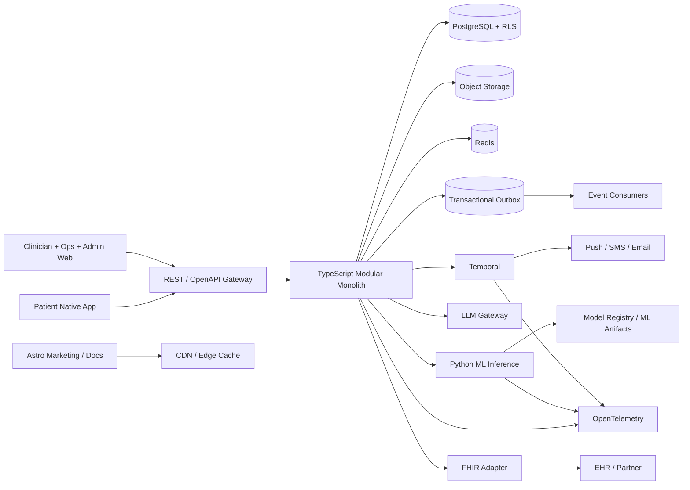
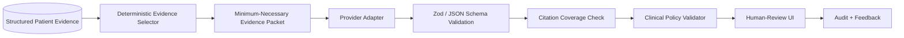

# Bina AI — Evidence-Based Product Definition, Architecture, Clinical/ML Plan, ADR Baseline, and Delivery Blueprint

**Research date:** 23 November 2026  
**Primary source:** Bina AI PRD v1.0, treated as the product-requirements authority. fileciteturn0file0  
**Secondary source:** the uploaded EyeCTester/EyeVitalSigns report, treated as a set of hypotheses rather than authoritative evidence; material claims were independently re-checked against FDA, ClinicalTrials.gov, CMS, peer-reviewed literature, and current product/framework documentation. fileciteturn0file1

**Evidence grading used below:** **A** = regulator, standards body, official public data source, randomized trial, or equivalent primary authority; **B** = peer-reviewed prospective/validation study; **C** = observational/retrospective evidence or systematic review; **D** = official engineering/product documentation; **E** = proposal or planning assumption requiring validation.

The architectural conclusion is clear: **Bina should be built as a clinical operations platform around a carefully validated functional-vision measurement system, not as an “AI eye diagnosis” product.** Its first defensible product is clinician-supervised monitoring of changes between visits, with explicit measurement quality, deterministic safety rules, longitudinal statistics, human escalation, and an evidence-grounded copilot. That is strongly consistent with the primary PRD. fileciteturn0file0

## Executive Strategy and Product Definition

The PRD’s strongest strategic choice is the decision to begin with AMD/high-risk retinal patients and deliberately avoid autonomous diagnosis or treatment recommendations. That boundary should be preserved. A home-monitoring system can have meaningful clinical value without claiming that it independently determines disease activity: the HOME randomized trial, for example, showed that telemonitored home hyperacuity testing in high-risk AMD patients resulted in less visual-acuity loss by the time CNV was detected than standard care, with median loss of 4 versus 9 letters; the trial did **not** establish that arbitrary smartphone testing or an unvalidated Bina implementation would produce the same effect. citeturn683817search0turn683817search1

EyeCTester provides a useful regulatory lesson. FDA records confirm 510(k) K203594, cleared on 7 September 2022, under the Digital Amsler Grid classification; the labeling describes an iOS prescription SaMD for adults 22 years and older, intended to aid eyecare providers in monitoring/detecting central or paracentral distortion and central 10-degree scotomas, and explicitly states that it is not intended to screen or diagnose. Its cited study NCT04607369 still had no posted results as of its April 2026 update. This validates the uploaded report’s central claim that the visible FDA indication is narrower than a broad “general eye-testing platform” story. citeturn955071search0turn955071search1turn999050view0

The recommended product definition is therefore:

> **Bina AI is a physician-enrolled remote functional-vision monitoring and care-operations platform that collects quality-controlled monocular visual-function measurements and symptoms between visits, identifies clinically reviewable change using validated rules/statistics, and gives the care team prioritized evidence, workflow, documentation, and communication tools.**

For launch, I would separate the system into six product surfaces rather than forcing every user into a single application:

| Surface | Primary users | Responsibility | Recommended implementation |
|---|---|---|---|
| Patient testing | Patient, caregiver | Calibrated VA/Amsler/symptoms, reminders, safe guidance | Native React Native/Expo |
| Clinician workspace | Retina physician/optometrist | Worklist, patient timeline, review, disposition, reports | React web |
| Monitoring operations | Coordinator/managed service | Outreach queue, contact scripts, SLA/escalation | Same staff web, separate role routes |
| Clinic administration | Admin, tenant owner | Enrollment, personnel, protocols, tenant configuration | Same staff web |
| Internal operations | CS, compliance, SRE/support | Deployments, support, audit-safe administration | Separate internal console |
| Research/sponsor | CRO/site/sponsor | Protocols, site monitoring, governed exports | Later module with strict research boundary |

The role-specific experience should be designed around **jobs**, not database entities. Patients need one obvious next action; physicians need a ranked list of people requiring review; coordinators need a queue with owner/due-time/next-action; clinic administrators need enrollment and operational health; customer success needs deployment/adoption information without inappropriate clinical privileges; sponsors need protocol and data-governance controls rather than normal clinic workflows.

The critical journeys should be formally modeled as state machines:

1. Clinic contract → DPA/BAA/security review → tenant provisioning → protocol approval → staff training → test patient → launch.
2. Patient enrollment → invitation → identity → consent → accessibility/language → device qualification → training → baseline series → baseline approval.
3. Scheduled test → preflight → monocular VA/Amsler → symptoms → quality classification → encrypted upload → immutable evidence → scoring → trend calculation.
4. Trigger → alert episode → coordinator review → repeat test/contact/escalation → clinician disposition → outcome label.
5. Pre-visit workflow → current test → longitudinal summary → clinician review → PDF/EHR export.
6. Managed-service workflow → due queue → outreach → documentation → SLA clock → clinic handoff.
7. Research workflow → study consent → protocol assignment → version-pinned measurements → data-quality review → locked export.

The PRD currently treats a baseline somewhat generically. That should change: **a clinical baseline should normally be a protocol-defined series of qualified observations**, not a single home measurement. The system must store exactly which sessions contributed, which device and protocol versions were used, and who approved replacement of a baseline. This is important because smartphone acuity has non-trivial repeatability limits and learning/environment effects. FrACT work shows that repeatability changes substantially with trial count, while home/mobile validation studies consistently emphasize standardization. citeturn683817search2turn683817search3turn683817search5

A practical claims ladder is preferable to attempting “SaMD everything” immediately:

| Stage | Defensible claim direction | Avoid |
|---|---|---|
| Prototype | Usability/research only | Clinical-performance statements |
| Controlled pilot | Collects functional measurements and supports clinician review | Disease detection sensitivity claims |
| Clinic-ready monitoring | Clinician-supervised monitoring of change, subject to applicable regulatory determination | “Diagnoses AMD activity” |
| Validated regulated product | Indication-specific performance demonstrated under locked protocol | Extrapolating validation to other diseases/devices |
| Research/pharma | Protocol-specific functional endpoints/data capture | Calling exploratory endpoints validated surrogate endpoints |

The most important product KPIs are not “AI accuracy” in isolation. They should include baseline completion, usable-test fraction, test-retest repeatability, missed-test rate, alert episodes per patient-month, actionable-alert PPV, missed clinically important deterioration, clinician review latency, coordinator minutes per active patient, escalation rate, support burden, digital-exclusion rate, and patient/clinician task completion. Those metrics directly constrain clinical safety and the managed-service unit economics.

## Clinical Science, Models, Datasets, and Validation

The system needs **three scientifically distinct data programs**: functional psychophysics, environment/test-quality sensing, and longitudinal clinical change. Retinal fundus/OCT imaging is a fourth, future program. Mixing those categories would create a misleading model-development plan.

**Visual acuity.** For the MVP, I recommend monocular **logMAR** acuity using a literacy-independent optotype such as Landolt C as the primary reference-aligned implementation, with tumbling E available if usability research demonstrates an advantage. ISO 8596 specifies Landolt rings for standardized acuity testing, while FrACT has decades of experience using Landolt C with Best-PEST-style adaptive threshold estimation. FrACT’s recent trial-count analysis found a strong precision/burden tradeoff: at 18 trials, test–retest limits of agreement were approximately ±0.17 logMAR; increasing to 48 trials improved this to roughly ±0.12 logMAR. Four-choice optotypes such as tumbling E generally require more trials than eight-orientation Landolt C for equivalent threshold information. citeturn660314search4turn683817search2turn683817search3

Peek Acuity is especially relevant because it demonstrates that well-designed smartphone acuity can be clinically useful. In a validation study of 300 adults aged 55 or older, smartphone acuity differed from ETDRS by a mean 0.07 logMAR and had reported test–retest limits around ±0.029 logMAR under that study’s conditions, with a testing time near 77 seconds. This is evidence that smartphone VA is feasible, not evidence that every smartphone implementation inherits Peek’s performance. citeturn683817search5

The Bina VA renderer should calculate **visual angle from physical screen geometry and validated viewing distance**, not simply render CSS/device-independent pixels. Pixel density and anti-aliasing materially affect small optotypes; FrACT specifically used anti-aliasing to address pixel discreteness, and later work on digital Landolt Cs likewise shows that rasterization can determine the smallest reliably represented gap. citeturn683817search2turn660314search1

Each raw VA trial should record at least:

`eye, optotype, orientation, physical/angular stimulus size, rendered pixel geometry, viewing-distance estimate + confidence, device display profile, answer, correctness, latency, app/protocol version, light/pose/stability measurements, retry state, timestamp`.

Do not store only the final logMAR score. Raw trial evidence is necessary for later validation, algorithm re-analysis, regulatory traceability, and anomaly review.

**Amsler/metamorphopsia.** Amsler is useful but should remain an explicitly noisy patient-reported functional map. Reviews characterize conventional Amsler testing as relatively rudimentary and subject to fixation, perceptual filling-in, drawing variability, and other limitations. Quantitative/digitized Amsler work—including analyses involving thousands of grids—suggests that richer spatial analysis is possible, but a public, mature, longitudinal smartphone dataset suitable for training Bina’s exact use case was not identified. citeturn238311search13turn238311search14turn238311search9

For MVP, use deterministic geometry: normalized distortion area, centroid, connected regions, change relative to that eye’s accepted baseline, repeat-confirmed change, and explicit fixation/quality metadata. Do not train an opaque CNN on drawings simply because it is possible.

An advanced option is a **hyperacuity/alignment task** rather than—or alongside—Amsler. Alleye’s validation provides useful precedent: in 63 wet AMD, 26 dry AMD, 19 age-matched healthy eyes, and 34 young healthy eyes, the age-matched healthy-versus-wet-AMD AUC was 0.845. A later prospective analysis reported a false-alarm rate around 6.1%, specificity about 93.8%, and PPV around 80% under that study design. Those are promising results for that product and protocol; they should be used to design Bina validation, not copied as Bina performance claims. citeturn683817search4turn167044search6

**Symptoms.** Red flags should be deterministic and clinically reviewed. Free-text NLP should only normalize language into structured concepts, identify possible urgency for human review, and perhaps generate a follow-up question. Because false reassurance is the dominant hazard, the safety objective is **red-flag recall**, not overall text-classification accuracy. The LLM/NLP system must never downgrade a structured red-flag response.

**Distance, pose, lighting, stability.** This is where native development is most justified. Apple ARKit exposes face position/orientation and relevant tracking information on supported devices; Google MediaPipe Face Landmarker provides on-device 3D face landmarks across supported platforms. In contrast, the Web Ambient Light Sensor remains limited/experimental, and browser camera constraints can be preferences rather than guaranteed hardware behavior. citeturn341024search0turn341024search1turn341024search3turn341024search5turn341024search6turn341024search7

A good quality subsystem should **not** begin as one learned “quality score.” Build interpretable components first:

| Component | MVP approach | Advanced approach | Validation |
|---|---|---|---|
| Face distance | Landmarks + calibrated device geometry + temporal median | Device-specific depth regression | Ruler/depth-ground-truth MAE, failure rate |
| Head/device pose | Face landmark geometry + IMU thresholds | Temporal classifier | Sensitivity to clinically invalid pose |
| Illumination | Native sensor where supported + exposure metadata | Calibrated lux estimator | Paired lux-meter measurements |
| Stability | IMU/camera-motion rules | Sequence classifier | Invalid-run detection |
| Response consistency | Repeated/catch-trial statistics | Psychometric latent-quality model | Association with reference repeatability |
| Completion/latency | Rules | Patient-specific anomaly model | False exclusion rate |

Ambient illumination should not be treated as cosmetic: contemporary portable-vision work and a 2026 illumination study support the conclusion that environment and display luminance can influence measured visual performance. citeturn660314search6turn660314search7

**Longitudinal change.** Start with statistics before machine learning. The recommended progression is:

| Stage | Method | Why |
|---|---|---|
| Baseline | Robust median/hierarchical estimate from qualified sessions | Resistant to one bad home measurement |
| Immediate change | Reliable-change threshold from observed test–retest variance | Transparent |
| Repeated change | Two-of-N or consecutive confirmation | Reduces noise-triggered alerts |
| Gradual drift | EWMA/CUSUM | Good for small persistent shifts |
| Research analysis | Mixed-effects model | Separates within-patient change from device/patient covariates |
| Advanced | Bayesian change point / state-space model | Handles uncertainty and irregular sampling |
| Later risk model | Calibrated logistic/GBM/survival model | Only after enough labeled prospective events |

The primary performance metrics should be **actionable PPV, clinically relevant sensitivity, lead time, alerts per patient-month, calibration, decision-curve utility, and subgroup/device performance**. ROC AUC alone is insufficient in a low-event-rate monitoring system because alert workload is driven by precision and prevalence.

The training/evaluation split is non-negotiable: **patient-level separation** must prevent either eye or repeated sessions from one patient entering multiple splits. A robust regulatory-development program should add clinic/site, time, language, and device holdouts. The final validation cohort must be prospectively frozen before threshold tuning.

**Dataset inventory.** The main public datasets often suggested for ophthalmology AI are valuable, but most do **not** train Bina’s MVP models:

| Dataset | Modality / verified scope | Appropriate Bina use | Restrictions / concern | Evidence |
|---|---|---|---|---|
| EyePACS/Kaggle DR | Fundus photographs, diabetic-retinopathy competition | Future fundus image research only | Kaggle competition/data rules; do not assume redistribution/commercial rights | Kaggle + EyePACS official material. citeturn440135search0turn440135search1turn440135search2 |
| Messidor | 1,200 retinal fundus images with DR/macular-edema-risk grades | Imaging benchmark | Official site specifies research/education use | citeturn440135search5 |
| Messidor-2 | Fundus examination pairs; official release includes 529 exams / 1,058 images originating from Messidor among its composition | Imaging validation | Research/education terms; commercial use requires diligence | citeturn440135search3turn440135search4 |
| AREDS | AMD natural-history/phenotype; dbGaP record reports ~134,500 macular photographs from 4,613 participants | Future AMD imaging/natural-history research | Controlled/authorized access | citeturn440135search6 |
| AREDS2 | AMD phenotype/genotype research data | Natural-history/covariate research | dbGaP consent/access groups; verify every requested modality | citeturn440135search7 |
| Kermany OCT | OCT CNV/DME/drusen/normal dataset with patient-independent split described | Future OCT research | Public listing and research-use wording/licensing need commercial reconciliation | citeturn440135search8turn440135search9 |
| Bina prospective pilot | Home VA + Amsler + symptoms + quality + outcomes | **Core Bina models** | Must be prospectively governed | Proposed |

The key research finding is the absence of a mature, openly accessible dataset combining **repeated home smartphone VA + Amsler/metamorphopsia + symptoms + camera-distance/light/pose telemetry + clinical outcome labels** at the scale required for a reliable learned risk model. Public retinal images cannot substitute for it. Therefore the first major data asset Bina needs to create is its own prospective longitudinal functional dataset.

The pilot data protocol should capture: repeated baseline sessions; clinic reference ETDRS/logMAR; OCT/fundus findings when available as outcomes/context; home raw trials; maps; structured/free-text symptoms; quality telemetry; device/OS/app versions; repeat-test outcomes; alert disposition; physician assessment; visit acceleration; treatment change as an outcome where legally/ethically appropriate; and support/adherence information. If model development is part of the study purpose, the consent/IRB/data-use language must say so rather than assuming that routine care data can automatically become training data.

A practical engineering/annotation estimate for the model program is:

| Subsystem | Initial effort | Annotation burden | Pilot gate |
|---|---:|---:|---|
| VA psychophysics/renderer | 6–10 eng/clinical-engineering weeks | Low; lab reference measurements | Bland–Altman/reference study |
| Distance/pose | 4–8 weeks | Medium; measured-distance lab set | Device-class error limits |
| Light/stability | 3–5 weeks | Low–medium | Lux/motion validation |
| Amsler deterministic mapping | 3–5 weeks | Low | Repeatability/usability |
| Symptom rules | 2–4 weeks | Clinician terminology review | 100% critical-rule fixture pass |
| Symptom NLP | 3–6 weeks after data | Hundreds–thousands clinician-labeled utterances | Red-flag recall/calibration |
| Trend engine | 4–8 weeks | Outcome adjudication | Shadow analysis |
| Learned risk | 8–20+ weeks **after sufficient events** | High; adjudicated longitudinal episodes | Prospective locked validation |
| LLM summary | 3–6 weeks | Clinician-rated evidence corpus | Factuality/citation/harm eval |

These are planning assumptions, not measured vendor estimates.

## Experience and Front-End Architecture

As of this research date, **Astro 7 is real and current**: Astro 7.0 was released in June 2026 and 7.4 in October 2026. Astro remains static-first but supports on-demand rendering, adapters, server islands, and route caching. That makes it an excellent choice for the public marketing, documentation, landing, security, and evidence site. citeturn275895search0turn275895search1turn275895search2

For the authenticated clinic application, I would not use Astro merely to standardize on one web framework. The current alternatives are healthy: Next.js 16 remains actively maintained; React Router’s current v8 line supports Framework Mode; and SvelteKit 3 was released in October 2026. citeturn275895search4turn275895search5turn275895search7

My recommended split is:

| Surface | Choice | Reason |
|---|---|---|
| Marketing / docs / evidence center | **Astro 7.4+** | Static-first, minimal JS, SEO, CDN economics |
| Clinician/admin/ops | **React Router v8 Framework Mode + React 19** | API-first, mature React ecosystem, avoids forcing domain/API logic into Next server abstractions |
| Patient calibrated testing | **React Native 0.88 + Expo SDK 58** | Native camera/sensor control, device qualification, offline/on-device ML |
| Patient web fallback | PWA/light React web | Consent, education, symptom questionnaires, support; not primary calibrated testing |

React Native 0.88 and Expo SDK 58 are the current compatible baseline in official documentation. citeturn275895search8turn275895search9

**Next.js is not a bad choice.** If the engineering team is already deeply experienced with Next 16, using it for staff web is reasonable. The reason I prefer React Router here is architectural: Bina should have a clear API/business backend independent of the browser framework. You do not need Next’s server-component/data-access architecture to achieve a fast authenticated dashboard, and reducing hidden coupling between UI framework and domain logic improves replaceability. Do not use both Next and React Router for equivalent staff applications.

SvelteKit 3 is technically strong and supports SSR, CSR, prerendering, and low-JS applications, but introducing both React Native and Svelte creates a second UI ecosystem. For a small-to-medium company, React across mobile/staff web has enough staffing/component/evaluation advantages that SvelteKit’s elegance does not outweigh stack diversity here. citeturn275895search6turn275895search7

**Why native for patient tests.** Browser APIs are adequate for ordinary camera apps, but calibrated clinical measurement requires more determinism. Camera constraint negotiation can be modified by the browser/device, while ambient-light access is not consistently available across browsers. Native stacks provide better access to AR/depth/face tracking, IMU, camera characteristics, display/device metadata, background/offline behavior, and controlled release testing. citeturn341024search0turn341024search3turn341024search5turn341024search6

The patient app should also work **without network during an active test**. A psychophysical threshold procedure should never pause because an API request stalls. The app downloads an approved, signed protocol; performs the test locally; records the complete evidence envelope; encrypts it locally if upload is unavailable; then uses idempotent synchronization. An offline urgent symptom must still display safe escalation wording, while the UI must explicitly avoid implying that the clinic has received or reviewed the result.

For web performance, Core Web Vitals currently center on LCP, INP, and CLS, with the usual “good” classification evaluated around the 75th percentile; LCP’s good threshold is 2.5 seconds or less. citeturn102933search5turn102933search7turn102933search8

I would enforce stricter internal budgets:

| Metric | Marketing | Staff web |
|---|---:|---:|
| p75 LCP | <1.8 s | <2.2 s |
| p75 INP | <150 ms | <180 ms |
| CLS | <0.05 | <0.05 |
| Initial route JS | <80 kB gzip target | <200 kB gzip target |
| Common API read p95 | — | <300 ms in-region |
| Heavy visualization | Lazy | Lazy |

Use CDN caching for Astro static routes, immutable hashed assets, image optimization, font subsetting/self-hosting where licensing permits, preconnect only where evidence shows benefit, route-level code splitting, lazy charting libraries, server streaming only where it makes perceived performance better, and Real User Monitoring plus Lighthouse/WebPageTest-style CI budgets.

**Accessibility must be stricter than ordinary SaaS.** WCAG 2.2 is the appropriate web baseline; it adds criteria covering target size, accessible authentication, focus visibility/obscuration, and other interactions. WCAG AA requires a 4.5:1 contrast ratio for normal text and 3:1 for qualifying large text. citeturn866690search0turn866690search2turn866690search3

Bina should use **WCAG 2.2 AA as a release gate** and voluntarily exceed it for critical low-vision workflows. The internal design system should favor 44–48 px touch targets even though WCAG’s AA minimum target criterion is less demanding, high default contrast, large typography, no information conveyed by color alone, visible focus, screen-reader semantics, OS text scaling, reduced motion, audio instructions, strong error recovery, and minimal memory requirements.

A special rule is needed for **clinical stimuli**: normal UI must respect accessibility scaling, but an acuity optotype cannot silently enlarge because the OS text scale changed. Clinical stimuli need a separate rendering package with physical/angular geometry validation; surrounding instructions remain accessible.

Localization needs to be architectural from day one. Persian and Arabic require semantic RTL, not “flip the CSS at the end.” Use logical CSS properties; bidi-isolate mixed identifiers/numbers; localize dates/numerals according to clinical needs; test strings at 30–50% expansion; store source clinical terminology separately from patient-facing translations; require medical review for red-flag wording; and test screen readers in English, Persian, and Arabic on target devices.

A patient test UX sequence should be extremely short: **“Today’s test” → environment check → eye/occlusion → VA → Amsler if scheduled → 3–6 symptom questions → completion**. Do not show a raw “risk score” to a patient. Use language such as “Your test was recorded,” “Please repeat this measurement,” or “Your care team should review this change,” consistent with the PRD’s safety intent. fileciteturn0file0

## Platform, AI Orchestration, Security, and Data Architecture

The strongest overall architecture is a **modular monolith plus durable workflow engine**, not microservices.



Microservices at this stage would add network contracts, service discovery, distributed authorization, distributed transactions, data ownership disputes, tracing complexity, and deployment overhead before there is any demonstrated scaling problem. The modular monolith can still be rigorously partitioned into bounded contexts and later extracted selectively.

The recommended stack is:

| Layer | Recommendation |
|---|---|
| Core language | TypeScript, strict mode |
| API | REST + OpenAPI |
| Domain architecture | Bounded contexts + hexagonal/ports-and-adapters |
| DB | PostgreSQL |
| Tenant isolation | `tenant_id` + PostgreSQL RLS + ABAC |
| Cache/rate limiting | Redis |
| Workflow | Temporal |
| Object evidence/report storage | S3-compatible encrypted object storage |
| Domain events | Transactional outbox initially |
| Search | PostgreSQL FTS initially |
| Auth | OIDC/SAML staff; WebAuthn/passkeys/MFA; patient OTP/deep link |
| IaC | Terraform/OpenTofu |
| Observability | OpenTelemetry |
| ML research/training | Python |
| ML serving | Python only where the model requires it |
| LLM orchestration | Deterministic TS first; LangGraph where justified |
| LLM tracing/evals | Langfuse after privacy review; OTel remains platform standard |
| Mobile | React Native / Expo |
| Public site | Astro |
| Staff UI | React Router |

PostgreSQL’s current RLS feature is well suited to defense-in-depth multi-tenancy; when RLS is enabled and no applicable policy exists, the behavior is default-deny. citeturn102933search10turn102933search13

Do not rely on application query filters alone. Every tenant-scoped row should carry `tenant_id`; DB sessions should acquire a verified tenant/security context; cross-tenant negative tests should execute against the actual database. “System admin” should not mean unrestricted default PHI access: use audited break-glass behavior.

**API design.** REST/OpenAPI should be canonical because Bina has native, web, Python, integration, sponsor, and potentially external consumer boundaries. tRPC is fine as an internal convenience if it never becomes the business contract. FHIR should remain an **adapter**, not Bina’s internal schema. The currently published core FHIR release is R5, while later work continues; real EHR partners frequently impose their own version/profile requirements, so the integration layer must negotiate against the partner capability statement rather than hard-code the entire domain around one FHIR release. citeturn102933search0turn102933search2

A core data model should include:

```text
Organization/Tenant
  └─ Clinic
      ├─ StaffMembership
      ├─ Patient
      │   ├─ CareTeamAssignment
      │   ├─ EyeProfile
      │   ├─ Enrollment
      │   ├─ ConsentVersionAcceptance
      │   ├─ DeviceQualification
      │   ├─ ProtocolAssignment
      │   ├─ TestSession
      │   │   ├─ TestTrial
      │   │   ├─ QualityObservation
      │   │   └─ RawEvidenceManifest
      │   ├─ SymptomReport
      │   ├─ BaselineVersion
      │   ├─ DerivedMeasurement
      │   ├─ TrendAssessment
      │   ├─ AlertEpisode
      │   │   ├─ AlertTrigger
      │   │   ├─ Review
      │   │   └─ Disposition
      │   ├─ ContactLog
      │   └─ ReportVersion
      └─ ProtocolTemplate
```

Three design principles matter particularly:

**Immutable evidence.** Never overwrite the original test to make new algorithms look clean. Store immutable trials/evidence and versioned derived measurements.

**Version everything clinically material.** Protocol, rule set, threshold, model, device qualification, prompt, language text, consent, and report template all need versions.

**Separate raw evidence from interpretation.** A test trial is evidence; `logMAR=...` is a derived measurement; `possible worsening` is an interpretation; an alert is an operational object. These should not be one mutable record.

A representative event taxonomy is:

`patient.enrolled`, `consent.accepted`, `device.qualified`, `baseline.approved`, `test.started`, `test.completed`, `test.quality_assessed`, `symptom.red_flag_detected`, `trend.changed`, `alert.opened`, `alert.acknowledged`, `contact.logged`, `alert.escalated`, `alert.closed`, `report.generated`, `export.created`, `protocol.published`, `model.promoted`.

Use a transactional outbox so a domain change and its event are committed atomically. Consumers must be idempotent.

**Temporal versus BullMQ.** Temporal is the better fit for the *complete* product. Its core design is durable execution for long-running workflows that survive crashes and resume state, and its TypeScript SDK supports this model. citeturn102933search18turn102933search30turn102933search43

Use Temporal for reminders, baseline completion windows, “repeat within 24 hours,” unacknowledged-alert escalation, managed outreach, study schedules, integration retries, and report orchestration. BullMQ is simpler for disposable background jobs but does not give you the same durable business-process semantics. If this were a two-person prototype I would tolerate BullMQ; for the platform described by the PRD, Temporal is worth adopting early.

**TypeScript/Python boundary.** TypeScript owns application/domain logic, APIs, workflow orchestration, LLM policy, authorization, and normal service code. Python owns experimentation, training, statistical/ML notebooks, dataset preparation, model evaluation, and inference services only where scientific Python materially helps. Python should **never write production domain tables directly**; it receives a versioned inference contract and returns a versioned output.

**LangChain/LangGraph/Langfuse.** Your instinct is directionally right, but I would use these more selectively than many teams do. LangGraph JS provides graph state, checkpointing/persistence, streaming, and human-in-the-loop/pause-resume semantics, and LangChain’s own guidance positions LangGraph as useful when deterministic and agentic/multi-step behavior must be combined. citeturn996110search1turn996110search2turn996110search6turn996110search7

Use **plain TypeScript** for:

- structured symptom normalization;
- one-shot clinical summary generation;
- template rewriting;
- explanation of an already-computed alert;
- provider failover/policy;
- deterministic evidence selection.

Use **LangGraph** only for bounded workflows such as:

`approved evidence fetch → timeline synthesis → draft → evidence-citation verification → prohibited-claim check → human approval`.

Do **not** put red-alert generation, VA calculations, risk severity, or emergency guidance inside an agent graph.

Langfuse’s current TypeScript SDK uses OpenTelemetry-style tracing and supports LangChain integration. It is valuable for prompt versioning/evaluation/traces, but PHI changes the decision materially: self-hosting or an approved region/contract may be necessary, and prompt/body tracing should be disabled or aggressively minimized unless the privacy/security basis is explicit. citeturn275895search10turn275895search11

OpenTelemetry remains the underlying system observability layer; its JS ecosystem is current and broad, independent of an LLM vendor. citeturn996110search5turn996110search20

The LLM dataflow should be:



Every output needs `model_provider`, `model_id`, `prompt_version`, `evidence_ids`, `generated_at`, and validation status.

Prompt injection controls should include strict separation between system policy and patient content, no arbitrary tools, schema-constrained output, tool allowlists, no untrusted text inserted into instruction strings, output validation, and no patient-supplied URLs being autonomously fetched.

**Security.** FDA’s current medical-device cybersecurity guidance explicitly expects lifecycle cybersecurity management, threat modeling, testing, architecture documentation, vulnerability management, and related premarket evidence for applicable devices. The February 2026 version superseded the June 2025 guidance and aligns with the updated QMSR context. citeturn866690search5turn866690search6

IEC 81001-5-1:2021 provides health-software lifecycle security requirements and is FDA-recognized, while FDA also warns that conformance by itself does not necessarily satisfy every Section 524B requirement. citeturn866690search7turn866690search8

Implement KMS envelope encryption, TLS, central secret management, short-lived workloads, least privilege, WebAuthn/MFA for staff, step-up authentication for export/privileged operations, break-glass access, immutable audit, production/non-production separation, dependency/SBOM management, signed artifacts, SAST/SCA/secrets scanning, incident response, penetration testing, backup restore exercises, and data-class-specific retention.

A reasonable clinic-ready internal reliability target is 99.95% monthly availability for core staff/API functions, ingest-to-worklist p95 below 60 seconds after successful upload, and a proposed RPO ≤15 minutes / RTO ≤4 hours. Those are **engineering targets**, not regulatory requirements.

## Regulatory, Quality, Reimbursement, and Commercial Operations

The launch jurisdiction is not a detail—it changes product architecture, claims, contracts, hosting, studies, and quality work. The primary PRD leaves it unresolved; that should become a P0 founder decision before commercial claims or billing design harden. fileciteturn0file0

For the United States, FDA’s digital-health guidance catalog has continued evolving; January 2026 brought updated final Clinical Decision Support and General Wellness guidance, while AI lifecycle/PCCP and cybersecurity guidance have also evolved. A patient-facing function can remain a regulated device function even when a provider CDS function might fall outside certain device definitions, so “it only supports decisions” is not itself a regulatory exemption. citeturn642993search5turn642993search6

For the EU, qualification/classification turns on intended purpose rather than whether the software happens to run as an app, cloud service, or embedded program. The MDCG medical-device-software guidance explicitly reflects that principle. citeturn215252view0

The EU AI Act adds another layer. Medical-device AI can fall into the high-risk regime where it is a product or safety component subject to third-party conformity assessment, with the applicable timetable depending on the final amended implementation schedule. Current EU material reflects staged enforcement into 2027–2028 for major high-risk categories. citeturn804885search0turn804885search2turn804885search3

The UK MHRA published updated SaMD market guidance in November 2026 covering qualification/classification, conformity, clinical investigation, and registration, while the UK government is continuing AI/medical-device reforms. citeturn642993search7turn642993search8

The recommended QMS/engineering standards baseline is:

| Standard / guidance | Why it matters | Current evidence |
|---|---|---|
| ISO 13485:2016 | Medical-device QMS | Confirmed current in 2025. citeturn600583search0 |
| ISO 14971:2019 | Medical-device risk management | Confirmed current in 2025. citeturn600583search1 |
| IEC 62304:2006 + A1:2015 | Medical-device software lifecycle | Current edition remains applicable; next edition work continues. citeturn600583search2 |
| IEC 62366-1:2015 + A1:2020 | Safety-related usability engineering | Relevant to critical patient tasks. citeturn600583search3 |
| IEC 82304-1:2016 | Health software product safety/security | Useful for software on general-purpose platforms. citeturn600583search4 |
| IEC 81001-5-1:2021 | Secure health-software lifecycle | Cybersecurity process baseline. citeturn866690search8 |
| IMDRF GMLP N88:2025 | ML-enabled medical-device good practices | Current international reference. citeturn600583search5 |
| ISO/TS 24971-2:2026 | ML-specific risk guidance with ISO 14971 | Explicitly focused on ML risk; does not cover generative/LLM systems as such. citeturn600583search9 |

The claims matrix should be a first-class release artifact:

| Claim | Jurisdiction | Function/version | Evidence | Regulatory status | Allowed wording | Owner |
|---|---|---|---|---|---|---|
| “Measures home VA” | US | VA protocol vX | comparison study | TBD | Research/pilot wording | RA |
| “Flags change for review” | US | trend engine vX | prospective validation | TBD | TBD | RA/Medical |
| “Reduces delay” | — | complete program | clinical outcomes study | None yet | **Do not claim** | Medical |
| “Supports RPM billing” | US | operations module | code/payer analysis | Not FDA claim | Very constrained | Compliance |

**Privacy.** Under HIPAA, a vendor handling PHI on behalf of a covered entity may be a business associate and normally needs a BAA; relevant subcontractors are also part of that chain. citeturn804885search6turn804885search7

Under UK GDPR, health information is special-category data requiring both an Article 6 lawful basis and an Article 9 condition, and high-risk processing can require a DPIA. citeturn804885search8turn804885search9

Do not store raw face video by default. Compute distance/pose locally, persist only minimum necessary derived measurements, and create a separate study/consent/data class if raw camera data is ever needed for model validation.

**US RPM reimbursement requires particular caution.** CMS currently describes RPM as requiring an internet-connected device meeting the FDA medical-device definition, with data electronically collected and automatically uploaded to a secure location. The 2026 code set expanded shorter-duration RPM pathways, including code 99445 for 2–15 days of device-supply data and 99470 for an initial shorter treatment-management interval, while existing codes remain relevant. citeturn497566search0turn497566search1turn497566search2turn497566search3

That does **not** mean “a smartphone eye test qualifies for RPM.” Bina must separately establish medical-device status where required, the nature of the data, automatic transmission, medical necessity, treatment-management requirements, payer-specific policy, practitioner/staff rules, and documentation. Treat reimbursement as a legal/coding configuration, not a baked-in product fact. This is one area where the uploaded competitive report should not be copied into sales messaging without fresh coding counsel. fileciteturn0file1

The product should nevertheless capture a configurable **billing-evidence ledger**: enrollment/setup, device/data days, successful uploads, treatment-management time, synchronous communication, staff identity, ordering practitioner, escalation/disposition, and attestations. It should not automatically submit claims in the first release.

**Commercial design.** The best structure is software-plus-optional-managed-service:

| Package | Contents |
|---|---|
| Pilot | Fixed implementation/research fee + patient cap + success review |
| Core | Native patient testing + clinician dashboard + standard reports |
| Pro | Alerts, advanced analytics, integrations, AI summaries |
| Managed | Pro + coordinator staffing/onboarding/outreach/escalation |
| Research | Protocol configuration + sites + governed exports + sponsor reporting |

Do not choose public pricing until the pilot measures workload. The key unit-economic equation is approximately:

`Gross contribution / patient = subscription revenue – cloud – messaging – LLM – support – allocated coordinator labor – integration variable cost`.

A useful **planning-only** sensitivity range is cloud/storage/observability of roughly \$0.50–\$4 per active patient-month, messaging \$0.20–\$2 depending geography/channel/frequency, LLM calls roughly \$0.05–\$1 under aggressively structured summaries, and coordinator labor from roughly 10–40 minutes/patient-month depending alert/adherence burden. These are **E-grade budgeting assumptions**, not market quotations, and should be replaced with actual vendor contracts and pilot time-motion data.

Managed-service staffing should therefore be modeled from observed **minutes per alert/contact/patient**, not a guessed patient-to-coordinator ratio.

The managed service needs its own clinical governance: staffed hours, holidays, unreachable-patient policy, red-flag routing, when the clinic becomes owner, what constitutes an emergency, quality sampling of coordinators, escalation drills, and an explicit distinction between “system received an alert,” “coordinator reviewed,” and “clinician reviewed.”

A good customer lifecycle is:

`lead → clinical fit → security/regulatory diligence → workflow workshop → contract/BAA/DPA → tenant provisioning → staff training → test patient → first cohort → two-week hypercare → monthly operational review → quarterly clinical/business review → renewal/expansion`.

Research/CRO should remain a distinct product mode with protocol, site, subject, eConsent, protocol-version locking, data-query/lock behavior, pseudonymized export, export manifests/hashes, study-specific permissions, and IRB/protocol retention.

## Repository Design, ADRs, and Engineering Governance

The repository should make the correct dependency direction obvious enough that an agent or new engineer has difficulty creating accidental coupling.

```text
bina/
├── apps/
│   ├── marketing-astro/
│   ├── staff-web/
│   ├── patient-mobile/
│   └── internal-console/
├── services/
│   ├── api/
│   ├── temporal-worker/
│   └── ml-inference/
├── contexts/
│   ├── identity-access/
│   ├── tenancy/
│   ├── patient-registry/
│   ├── enrollment-consent/
│   ├── protocols/
│   ├── testing/
│   ├── quality/
│   ├── symptoms/
│   ├── baselines/
│   ├── trends/
│   ├── alerts/
│   ├── care-operations/
│   ├── reporting/
│   ├── notifications/
│   ├── billing-evidence/
│   ├── research/
│   ├── integrations/
│   ├── ai-copilot/
│   └── audit-compliance/
├── packages/
│   ├── domain-kernel/
│   ├── contracts-openapi/
│   ├── event-schemas/
│   ├── db/
│   ├── authz/
│   ├── clinical-rules/
│   ├── test-protocols/
│   ├── clinical-renderer/
│   ├── ui/
│   ├── i18n/
│   ├── observability/
│   ├── feature-policy/
│   └── test-fixtures/
├── ml/
│   ├── datasets/
│   ├── features/
│   ├── experiments/
│   ├── training/
│   ├── evaluation/
│   ├── registry/
│   └── model-cards/
├── infra/
│   ├── terraform/
│   ├── deployment/
│   ├── policies/
│   └── runbooks/
├── docs/
│   ├── adr/
│   ├── requirements/
│   ├── risk/
│   ├── claims/
│   ├── clinical/
│   ├── security/
│   ├── regulatory/
│   └── api/
└── tests/
    ├── e2e/
    ├── contract/
    ├── accessibility/
    ├── security/
    ├── clinical-fixtures/
    └── performance/
```

The hard dependency rules should be enforced in CI:

- apps cannot import repositories/database internals;
- one bounded context cannot import another context’s internal entities/repositories;
- `clinical-rules` cannot depend on an LLM or vendor SDK;
- `ai-copilot` can query approved evidence ports but cannot mutate alert severity or source evidence;
- domain contexts never import Twilio/AWS/vendor-specific SDKs directly;
- Python cannot write domain tables;
- FHIR mappings remain within integration adapters;
- every external contract is versioned;
- migration lint prevents creation of a tenant table without RLS;
- event schema compatibility is tested;
- architecture boundaries are checked with ESLint/dependency-cruiser-like rules.

The plugin architecture for future tests should look roughly like:

```ts
export interface VisionTestDefinition<
  TProtocol,
  TRawEvidence,
  TMeasurement
> {
  readonly type: string;
  validateProtocol(protocol: TProtocol): ValidationResult;
  deviceRequirements(protocol: TProtocol): DeviceRequirement[];
  score(
    evidence: TRawEvidence,
    context: ScoringContext
  ): Promise<VersionedMeasurement<TMeasurement>>;
}
```

Alert logic should depend on an interface such as:

```ts
export interface ClinicalSignalEvaluator {
  evaluate(input: QualifiedPatientEvidence): ClinicalSignal[];
}
```

LLM providers should be behind:

```ts
export interface StructuredLanguageModel {
  generate<T>(
    request: StructuredGenerationRequest<T>
  ): Promise<StructuredGenerationResult<T>>;
}
```

No feature should instantiate an OpenAI/Anthropic/etc. SDK directly.

The accepted ADR baseline should be:

| ADR | Decision | Status |
|---|---|---|
| ADR-001 | Modular monolith before microservices | Accepted |
| ADR-002 | Native patient testing; web fallback for non-calibrated flows | Accepted |
| ADR-003 | Astro 7.x for marketing/docs | Accepted |
| ADR-004 | React Router v8 for staff web | Accepted |
| ADR-005 | REST/OpenAPI canonical API | Accepted |
| ADR-006 | FHIR as integration adapter | Accepted |
| ADR-007 | PostgreSQL + tenant RLS | Accepted |
| ADR-008 | Immutable raw evidence; versioned derived facts | Accepted |
| ADR-009 | Transactional outbox | Accepted |
| ADR-010 | Temporal for long-running workflows | Accepted |
| ADR-011 | Deterministic safety logic before ML | Accepted |
| ADR-012 | Statistical trend baseline before learned risk | Accepted |
| ADR-013 | LLM transforms evidence; never owns clinical decision | Accepted |
| ADR-014 | LangGraph only for bounded multi-step workflows | Accepted |
| ADR-015 | OpenTelemetry platform telemetry | Accepted |
| ADR-016 | No raw face video by default | Accepted |
| ADR-017 | Explicit supported-device qualification | Accepted |
| ADR-018 | Separate clinical stimulus renderer | Accepted |
| ADR-019 | OIDC/SAML + MFA/passkeys staff; OTP patients | Accepted |
| ADR-020 | RBAC + ABAC | Accepted |
| ADR-021 | KMS envelope encryption | Accepted |
| ADR-022 | IaC and immutable promotion | Accepted |
| ADR-023 | Cloud region chosen after jurisdiction | Pending |
| ADR-024 | Requirements/risk traceability from pilot | Accepted |
| ADR-025 | Claims matrix is a release gate | Accepted |
| ADR-026 | RPM evidence capture, no automatic billing assumption | Accepted |
| ADR-027 | Research and operational data governance separated | Accepted |
| ADR-028 | Feature flags include policy/jurisdiction/device eligibility | Accepted |
| ADR-029 | Deterministic/versioned reports | Accepted |
| ADR-030 | Any microservice extraction requires a new ADR | Accepted |
| ADR-031 | Alerts are deduplicated episodes | Accepted |
| ADR-032 | ML promotion requires shadow/canary evaluation | Accepted |
| ADR-033 | Patient-level ML splits mandatory | Accepted |
| ADR-034 | No implied 24/7 emergency monitoring | Accepted |
| ADR-035 | Accessibility/RTL are architecture requirements | Accepted |
| ADR-036 | Retention is policy-as-code by data class | Accepted |
| ADR-037 | Fundus/OCT AI is a separate future program | Deferred |
| ADR-038 | Contrast/color as test plugins, not MVP | Deferred |
| ADR-039 | Canonical domain event taxonomy | Accepted |
| ADR-040 | Architecture conformance enforced in CI | Accepted |

This approach directly addresses the requested OCP/SRP/DRY goal. “Open for extension” comes from protocol/test/provider/integration interfaces and event contracts; “closed for modification” means adding glaucoma testing, a new LLM provider, a new jurisdictional alert policy, or a FHIR partner should not require editing core VA/trend classes across the repository.

Avoid a generic `GodService`, a 3,000-line `PatientService`, or a shared `utils` dumping ground. A bounded context owns its schema, application services, ports, and tests. Shared packages should exist only for genuinely stable cross-cutting primitives.

## Delivery Plan, Agent Tasks, RACI, Risk, and Effort

The software can be prototyped quickly; the **clinical product cannot responsibly be compressed into an 8–12-week software-only schedule**. The 8–12-week PRD pilot target is realistic only if it means a controlled, narrowly scoped pilot using a pre-specified protocol, explicit clinical oversight, and limited claims—not a fully validated commercial medical device. fileciteturn0file0

A recommended rollout is:

| Phase | Purpose | Gate to exit | Rough effort assumption |
|---|---|---|---|
| Prototype | Validate UX/psychophysics/device feasibility | Bench tests + formative usability | 8–12 engineer-weeks |
| Controlled pilot | Validate workflow/data quality/safety | IRB/appropriate governance + 30–100 pts | 30–50 eng-weeks + 8–16 ML/clinical-engineering weeks |
| Clinic-ready | Multi-tenant/reliable/secure/managed ops | Security, DR, SLA, operational capacity | +40–70 eng-weeks |
| Regulated | Intended-use clinical validation/QMS/submission | Jurisdiction-specific evidence | commonly 6–18+ months parallel program |
| Research/pharma | Protocol/site/export capabilities | Research QA and sponsor validation | independent workstream |

The detailed implementation sequence should be agent-executable but safety-gated:

| Epic / task group | P | Dependencies | Acceptance evidence |
|---|---:|---|---|
| Repository, CI, architectural boundaries | 0 | None | Clean clone builds/tests; illegal imports fail |
| Requirements/risk/claims IDs | 0 | None | REQ→HAZ→control→verification trace exists |
| Freeze intended use | 0 | Regulatory owner | Approved jurisdictional wording |
| VA protocol v1 | 0 | Clinical/psychophysics | Versioned spec + simulator tests |
| Amsler protocol v1 | 0 | Clinical | Geometry fixtures |
| Red-flag protocol v1 | 0 | Medical Director | 100% critical fixture pass |
| Postgres tenancy/RLS | 0 | Repo | DB-level cross-tenant tests |
| Audit/outbox | 0 | DB | Crash/retry and atomicity tests |
| Staff identity | 0 | Tenant model | SSO/MFA/step-up tests |
| Patient invitation/consent | 0 | Identity | Replay/rate-limit/version tests |
| Protocol registry | 0 | Clinical specs | Published versions immutable |
| RN mobile shell/i18n/RTL | 0 | Repo | EN/FA/AR a11y smoke tests |
| Device registry | 0 | Mobile/protocol | Unsupported device safely blocked |
| Clinical stimulus renderer | 0 | VA protocol | Physical-size/golden fixtures |
| Distance/pose preflight | 0 | Renderer/native | Ground-truth lab results |
| Illumination/stability | 1 | Native | Paired measurement results |
| VA engine | 0 | Renderer/preflight | Simulated-observer tests |
| Amsler | 0 | Protocol | Geometry/repeatability tests |
| Symptoms | 0 | Red-flag protocol | Offline safety tests |
| Encrypted offline queue | 0 | Mobile | Airplane/restart/idempotency tests |
| Ingestion/raw evidence | 0 | DB/protocol | Version/tenant/idempotency tests |
| Quality evaluator | 0 | Evidence | Reason-specific fixtures |
| Baseline builder | 0 | Quality | No excluded session contribution |
| Trend engine | 0 | Baseline | Stable/noisy/step/drift simulations |
| Alert episode engine | 0 | Trend/symptoms | Dedup and non-suppressible red flags |
| Temporal workflows | 0 | Outbox | Crash/resume/time-skipping tests |
| Staff web/worklist | 0 | API/auth | RBAC + accessibility |
| Patient timeline/disposition | 0 | Worklist | Eye-safe/timezone-safe fixtures |
| Contact logs/escalation | 0 | Workflow | SLA state-machine tests |
| OTel/security baseline | 0 | Foundation | PHI-safe telemetry |
| Evidence packet + LLM abstraction | 1 | Timeline | Tenant-safe snapshot fixtures |
| Structured summaries | 1 | LLM abstraction | Hallucination/citation/harm eval |
| PDF reports | 1 | Timeline | Version/source hash |
| Device laboratory study | 0 gate | Patient app | Defined distance/rendering limits |
| Formative human factors | 0 gate | Patient app | Critical use errors controlled |
| ETDRS comparison study | 0 | Device study | Prespecified Bland–Altman analysis |
| IRB/data protocol | 0 | Pilot | Approved collection/training use |
| Small cohort 5→15→30+ | 0 | All pilot gates | Safety/data-quality checkpoint |
| Shadow risk models | 1 | Enough outcomes | Frozen split, no production impact |
| Multi-clinic hardening | 0 later | Pilot | RLS penetration test |
| Managed console | 1 | Time-motion data | Capacity/SLA model |
| Billing evidence | 2 | Coding decision | Reconciled audit export |
| FHIR adapter | 2 | Partner | Partner sandbox contract |
| Formal ISO/QMS/regulatory package | 0 regulated | Stable product | RA/QA approval |

The **Definition of Done** for every clinically material task should include implementation, automated tests, updated API/schema/event docs, accessibility review where relevant, privacy/threat impact, telemetry, rollback strategy, requirement/risk-control traceability, and the required clinical/security/QA sign-off. A coding agent must never mark a clinical task complete merely because unit tests are green.

Parallelization is possible. The engineering foundation, Astro marketing work, staff design system, mobile shell, and study-protocol drafting can run simultaneously. Clinical stimulus rendering depends on the VA protocol; trend work depends on actual measurement semantics; the learned risk model depends on prospective labels and therefore cannot be “parallelized” into existence.

The highest-priority risks are:

| Risk | Severity | Key controls |
|---|---|---|
| False reassurance / missed deterioration | Critical | Independent red-flag rules, no “all clear,” human escalation, validation |
| Invalid home measurement | High | Native preflight, device qualification, quality exclusion |
| Alert fatigue | High | Episode dedup, repeat confirmation, PPV/burden monitoring |
| Wrong-eye/occlusion behavior | High | Human-factors design; do not overclaim automated detection |
| Cross-tenant PHI leak | Critical | RLS + ABAC + pen testing |
| LLM fabrication | High | Evidence packet, schema, citation verifier, policy validator, HITL |
| OS/device update invalidates calibration | High | Device registry, staged release, kill switch |
| Regulatory claim creep | High | Claims matrix + release approval |
| Managed service mistaken for emergency service | Critical | Explicit staffed hours and emergency wording |
| Dataset leakage | High | Patient/site/time holdouts |
| Digital exclusion | High | Caregiver, audio, RTL, support, alternate pathway |
| Coordinator workload exceeds economics | Medium/high | Time-motion study, tune alert thresholds before scaling |

The RACI should put **Medical Director** accountable for clinical protocol/safety; **CTO** accountable for architecture and platform security; **QA/RA** accountable for design-control/QMS/regulatory artifacts; **DPO/privacy lead** for data governance; **PI/biostatistician** for study design and statistical analysis; **COO/Clinical Ops** for managed monitoring; **Product/CS** for adoption; and **Legal/RA/Medical** jointly approving external clinical/reimbursement claims.

## Reference Catalog, Verification Notes, and Downloadable Artifacts

The most important independently verified references and implementation sources are below. Direct URLs are included because you explicitly requested a source catalog.

| Area | Source and direct URL | Grade / note |
|---|---|---|
| Bina requirements | Uploaded Bina PRD fileciteturn0file0 | Primary project authority |
| EyeCTester hypotheses | Uploaded competitor report fileciteturn0file1 | Secondary; independently checked |
| HOME RCT | [PubMed](https://pubmed.ncbi.nlm.nih.gov/24211172/) | **A**, randomized trial; DOI 10.1016/j.ophtha.2013.10.027. citeturn683817search0 |
| HOME design | [PMC](https://pmc.ncbi.nlm.nih.gov/articles/PMC11554420/) | **A/B**, protocol/design; DOI 10.1016/j.cct.2014.02.003. citeturn683817search6 |
| Peek Acuity | [JAMA Ophthalmology](https://jamanetwork.com/journals/jamaophthalmology/fullarticle/2296911) | **B**, smartphone VA validation; DOI 10.1001/jamaophthalmol.2015.1468. citeturn683817search5 |
| FrACT original | [PubMed](https://pubmed.ncbi.nlm.nih.gov/8867682/) | **B**, Best-PEST/Landolt C; DOI 10.1097/00006324-199601000-00008. citeturn683817search2 |
| FrACT trials/repeatability | [PMC](https://pmc.ncbi.nlm.nih.gov/articles/PMC11868300/) | **B**, 2024 trial-count study; DOI 10.1007/s00417-024-06638-z. citeturn683817search3 |
| Alleye validation | [PMC](https://pmc.ncbi.nlm.nih.gov/articles/PMC7002442/) | **B**, mobile hyperacuity; DOI 10.1038/s41433-019-0455-6. citeturn683817search4 |
| EyeCTester FDA | [FDA 510(k) K203594](https://www.accessdata.fda.gov/scripts/cdrh/cfdocs/cfpmn/pmn.cfm?ID=K203594) | **A**, verified indication. citeturn955071search0 |
| EyeCTester study | [ClinicalTrials.gov NCT04607369](https://clinicaltrials.gov/study/NCT04607369) | **A**, no posted results as checked. citeturn955071search1 |
| EyePACS | [Kaggle](https://www.kaggle.com/c/diabetic-retinopathy-detection) | Imaging only; competition rules apply. citeturn440135search0turn440135search1 |
| Messidor | [ADCIS](https://www.adcis.net/en/third-party/messidor/) | **A source for dataset terms**, research/education. citeturn440135search5 |
| Messidor-2 | [ADCIS](https://www.adcis.net/en/third-party/messidor2/) | Dataset/license diligence. citeturn440135search3 |
| AREDS | [dbGaP](https://www.ncbi.nlm.nih.gov/projects/gap/cgi-bin/study.cgi?study_id=phs000001) | **A**, controlled access. citeturn440135search6 |
| Kermany OCT | [Mendeley Data](https://data.mendeley.com/datasets/rscbjbr9sj/3) | Imaging only; resolve license-use wording before commercial use. citeturn440135search8turn440135search9 |
| FDA Digital Health guidance | [FDA](https://www.fda.gov/medical-devices/digital-health-center-excellence/guidances-digital-health-content) | **A**, current regulatory source. citeturn642993search5 |
| FDA cybersecurity | [FDA](https://www.fda.gov/medical-devices/medical-device-cybersecurity) | **A**, current Feb 2026 guidance trail. citeturn866690search5turn866690search6 |
| EU MDSW qualification | [European Commission MDCG 2019-11](https://health.ec.europa.eu/document/download/b45335c5-1679-4c71-a91c-fc7a4d37f12b_en) | **A**, official guidance. citeturn215252view0 |
| UK SaMD | [MHRA/GOV.UK collection](https://www.gov.uk/government/collections/software-and-artificial-intelligence-ai-as-a-medical-device) | **A**, current UK route. citeturn642993search7 |
| ISO 13485 | [ISO](https://www.iso.org/standard/59752.html) | **A**, QMS. citeturn600583search0 |
| ISO 14971 | [ISO](https://www.iso.org/standard/72704.html) | **A**, risk management. citeturn600583search1 |
| IEC 62304 | [IEC](https://webstore.iec.ch/en/publication/3842) | **A**, software lifecycle. citeturn600583search2 |
| IEC 62366-1 | [IEC](https://webstore.iec.ch/en/publication/63193) | **A**, usability engineering. citeturn600583search3 |
| IEC 82304-1 | [IEC](https://webstore.iec.ch/en/publication/26107) | **A**, health software. citeturn600583search4 |
| IEC 81001-5-1 | [IEC](https://webstore.iec.ch/en/publication/63293) | **A**, cybersecurity lifecycle. citeturn866690search8 |
| WCAG 2.2 | [W3C](https://www.w3.org/TR/WCAG22/) | **A**, accessibility. citeturn866690search4 |
| CMS RPM | [CMS Remote Patient Monitoring](https://www.cms.gov/medicare/coverage/telehealth/remote-patient-monitoring) | **A**, current billing framework. citeturn497566search1 |
| Astro | [Astro 7 announcement](https://astro.build/blog/astro-7/) | **D**, official. citeturn275895search0 |
| React Router | [Official changelog](https://reactrouter.com/changelog) | **D**, v8 current line. citeturn275895search5 |
| Expo | [Expo SDK documentation](https://docs.expo.dev/versions/latest/) | **D**, SDK 58 baseline. citeturn275895search9 |
| LangGraph JS | [Official docs](https://docs.langchain.com/oss/javascript/langgraph/overview) | **D**, graph orchestration. citeturn996110search1 |
| Langfuse TS | [Official docs](https://langfuse.com/docs/sdk/typescript/guide) | **D**, LLM tracing/evals. citeturn275895search10 |
| OpenTelemetry JS | [Official docs](https://opentelemetry.io/docs/languages/js/) | **D**, observability. citeturn996110search5 |
| PostgreSQL RLS | [PostgreSQL](https://www.postgresql.org/docs/current/ddl-rowsecurity.html) | **D**, tenant isolation feature. citeturn102933search13 |
| Temporal | [Official docs](https://docs.temporal.io/) | **D**, durable workflows. citeturn102933search18 |
| FHIR | [HL7 FHIR](https://hl7.org/fhir/) | **A/D**, interoperability standard. citeturn102933search0 |

Several points from the original materials require explicit correction or qualification. The competitor report’s core EyeCTester clearance statement is substantially supported, but Bina should **not** infer that broad visual-acuity/contrast/color/monitoring functionality is covered by that particular FDA clearance. fileciteturn0file1 citeturn955071search0turn999050view0 CMS RPM changed materially in 2026, so old “16 days only” summaries are no longer sufficient; the current code landscape includes shorter-duration pathways, but Bina’s eligibility remains fact-specific. citeturn497566search0turn497566search2 Astro 7 is no longer speculative—it is released and appropriate for the static/public surface, while React Native remains preferable for calibrated patient testing. citeturn275895search0turn275895search1turn275895search8

The biggest unresolved decisions that cannot responsibly be “researched away” are the **initial jurisdiction**, precise **intended use/claim**, design-partner clinic, whether the first pilot is clinical care versus research, exact managed-service coverage model, and the prospective clinical-validation protocol. These need founder/medical/regulatory decisions before some downstream ADRs can be finalized.

The requested implementation artifacts are available here:

[Master PDR / PRD](sandbox:/mnt/data/Bina_AI_Master_PDR_PRD.md)  
[Architecture Decision Records — ADR-001 through ADR-040](sandbox:/mnt/data/Bina_AI_ADRs.md)  
[Agent-Executable TASKS / Delivery Plan](sandbox:/mnt/data/Bina_AI_TASKS.md)
